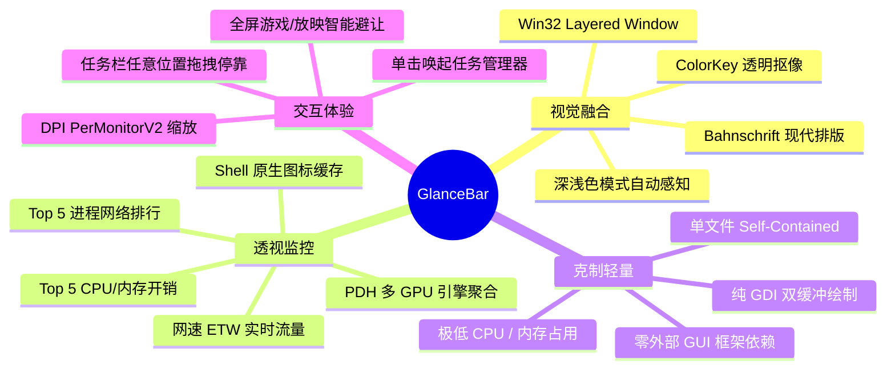
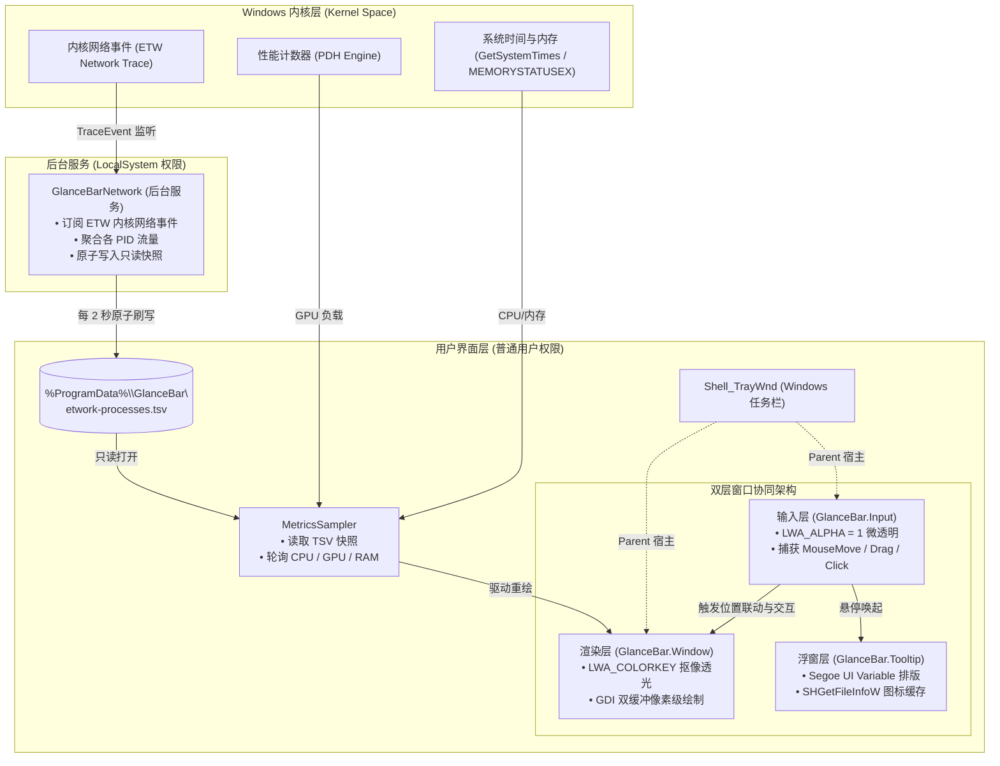

<div align="center">

# ⚡ GlanceBar (任务栏脉搏)

**轻若微风、直观灵动的 Windows 任务栏极简硬件状态监视器**  
*Featherlight, Transparent & Native Hardware Performance Monitor for Windows Taskbar*

<br/>

[-0078D6?style=for-the-badge&logo=windows&logoColor=white)](https://www.microsoft.com/windows)
[-512BD4?style=for-the-badge&logo=dotnet&logoColor=white)](https://dotnet.microsoft.com/)
[](https://docs.microsoft.com/windows/win32/)
[](#-为什么做它与传统工具对比)
[](#-快速开始)

<br/>

*「将机器的心跳，轻柔无感地融进任务栏的呼吸之中。」*

[💡 设计哲学](#-设计哲学) • [🖥️ 视觉与交互](#️-视觉与交互全景) • [✨ 核心亮点](#-核心亮点) • [📊 对比传统工具](#-与传统工具对比) • [🛠️ 底层架构](#️-底层硬核技术揭秘) • [🚀 快速开始](#-快速开始) • [❓ 常见问题](#-常见问题-faq)

</div>

---

## 💡 设计哲学

日常使用 PC 时，我们常常好奇或需要关注：“现在网速有多快？”、“是什么程序在偷偷吃 CPU？”、“为什么内存又满了？”。

然而市面上的监控工具总有些令人妥协的遗憾：
* **独立桌面悬浮窗**：遮挡壁纸或工作窗口，切全屏时容易误触，视觉风格与 Windows 11 Fluent 风格割裂。
* **现代 Webview/Electron 类小挂件**：仅为了看个网速就常驻消耗数百兆内存与额外 GPU 资源，本末倒置。
* **传统任务栏插件**：布局固定死板无法随心摆放，高分屏 DPI 缩放模糊，且**只能看总体数值，看不到究竟是哪个后台进程在偷跑资源**。

**GlanceBar** 诞生于对“克制、原生与极致优雅”的偏执追求：
1. **纯粹原生**：摒弃沉重的 UI 框架，采用纯 Win32 API 与 GDI 双缓冲绘制，字体选用 Win11 原生 **Bahnschrift**，严丝合缝融进任务栏。
2. **通透隐匿**：利用 ColorKey 色键抠像实现真正的穿透透明，无边框、无底色块，深浅色主题毫秒自适应。
3. **悬停透视**：平时仅占任务栏一隅，鼠标滑过瞬间即可穿透直达占用资源的 **Top 5 进程排行榜，并提取该进程的原生高清图标**。
4. **自由停靠**：任务栏任意位置随手拖动摆放，自动计算相对坐标并持久化记忆。

---

## 🖥️ 视觉与交互全景

### 1. 任务栏常驻态（极简、通透、不喧宾夺主）

在任务栏托盘或空白区以极其轻巧的微条常驻，与 Windows 11 原生视觉浑然一体：

```text
 ┌─── Windows 11 任务栏 (Taskbar) ────────────────────────────────────────────────────────┐
 │ [⊞] [🔍] [Widgets] [Apps...]               ↓ 12.5M  ↑ 1.2M   🔲 24   💻 18   💾 57    │
 └────────────────────────────────────────────────────────────────────────────────────────┘
                                               └──┬──┘  └──┬─┘   └─┬─┘   └─┬─┘   └─┬─┘
                                                下载速度  上传速度  CPU负载 GPU负载 内存占比
```

* **自适应色谱**：
  * **下载速度**：定标清透海蓝（深色模式 `#7EC8F6` / 浅色模式 `#0067C0`）；
  * **上传速度**：定标优雅淡紫（深色模式 `#C6A0E8` / 浅色模式 `#7748A8`）；
  * **硬件状态**：跟随系统主题色（深浅色自适应前景色，灰度克制，不抢视觉主焦点）。
* **像素级纯矢量图标**：微处理器芯片、显卡卡槽、内存 DIMM 条与上下行箭头均由纯 GDI 像素级点阵绘制，高分屏下锐利无锯齿。

---

### 2. 鼠标悬停态（穿透明细浮窗）

无需呼出任务管理器，鼠标滑过微条对应区域，即刻呼出毛玻璃质感进程透视卡片：

```text
┌── 悬停在【网速】区域 ──────────────────────┐  ┌── 悬停在【CPU】区域 ───────────────────────┐
│ 网速 · Wi-Fi 6 (Intel Wi-Fi 6 AX200)      │  │ CPU  24%                                 │
│ 下载 12.50 MB/s       上传 1.18 MB/s      │  │                                          │
│ ────────────────────────────────────────  │  │ 占用 CPU 排行                            │
│ 占用网速                                  │  │  🎨 Photoshop.exe                 14.2%  │
│  🌐 msedge.exe       ↓ 11.20 MB/s  ↑ 40 KB│  │  ⚙️ svchost.exe                    4.1%  │
│  🎮 Steam.exe        ↓  1.10 MB/s  ↑ 12 KB│  │  🌐 msedge.exe                     3.5%  │
│  💬 WeChat.exe       ↓   80 KB/s   ↑ 1.1 MB│  │  🎵 Spotify.exe                    1.2%  │
└───────────────────────────────────────────┘  └──────────────────────────────────────────┘

┌── 悬停在【内存】区域 ──────────────────────┐  ┌── 悬停在【GPU】区域 ───────────────────────┐
│ 内存  57%        18.24 GB / 32.00 GB      │  │ GPU 总利用率                             │
│ ────────────────────────────────────────  │  │                                          │
│ 占用内存排行                              │  │ 目前负载：18%                            │
│  🎮 Cyberpunk2077.exe            6.42 GB  │  │ （实时聚合最繁忙 DirectX 图形引擎）      │
│  🌐 msedge.exe                   1.85 GB  │  │                                          │
│  💻 devenv.exe                   1.20 GB  │  │                                          │
└───────────────────────────────────────────┘  └──────────────────────────────────────────┘
```

> [!TIP]
> 浮窗中的进程图标不是通用占位图，而是通过 Windows Shell API 动态提取的各应用真实小图标，一眼即可分辨目标进程。

---

### 3. 便捷交互速查

| 交互操作 | 响应动作 | 设计细节与实现机制 |
| :--- | :--- | :--- |
| **鼠标悬停 (Hover)** | 毫秒级呼出对应指标透视窗 | 悬停网速、CPU、内存显示 Top 5 进程排行；悬停 GPU 显示图形引擎负载。 |
| **按住左键拖拽 (Drag)** | 在任务栏任意位置自由滑动停靠 | 按下并位移 > 2px 即进入拖拽模式，松开时自动将归一化坐标存入注册表。 |
| **左键单击 (Click)** | 极速呼出 Windows 任务管理器 | 单击未发生拖动时，瞬间以系统原生协议唤起 `taskmgr.exe`。 |
| **右键单击 (Right Click)** | 打开快捷托盘菜单 | 提供 **“打开任务管理器”**、**“开机启动 (联动勾选)”** 与 **“退出程序”**。 |
| **全屏应用 / 游戏 / PPT** | 智能无感隐匿 | 监听 `SHQueryUserNotificationState`，全屏游戏或演示时不抢视觉焦点。 |

---

## ✨ 核心亮点



- **🎨 真正的任务栏一体化沉浸**：  
  利用双层窗口架构（Dual-layered Windows），以 `WS_EX_LAYERED` 与 `LWA_COLORKEY` 技术实现文字与矢量图标浮空于任务栏背景之上，无任何灰边或矩形背景框阻断视线。
- **🔍 进程级资源精准溯源**：  
  区别于大多数只展示总网速的插件，GlanceBar 借助 ETW（Event Tracing for Windows）技术聚合每个进程的收发字节，谁在后台消耗宽带一目了然。
- **📐 完美的 PerMonitorV2 高清缩放**：  
  精准响应高分屏与跨显示器 DPI 切换通知，矢量图标笔触与字体高度按比例平滑重算，4K 甚至 8K 屏幕下依然锐利细腻。
- **🎮 游戏与演示智能隐匿**：  
  工作时提供数据参考，娱乐时不打扰——检测到 Direct3D 全屏游戏独占或处于演示放映模式时自动隐藏，退出全屏后平滑恢复。

---

## 📊 与传统工具对比

| 评估维度 | 传统悬浮窗工具 (如 TrafficMonitor 等) | 任务栏挂件 (如某些三方管家插件) | 现代 Webview / Electron 挂件 | **GlanceBar** |
| :--- | :--- | :--- | :--- | :--- |
| **视觉呈现** | 独立浮窗，遮挡壁纸或窗口 | 需强行注入任务栏，易崩溃或错位 | 占用大，风格不原生 | **原生贴合任务栏，ColorKey 通透穿透** |
| **资源占用** | 20MB ~ 60MB 内存 | 常绑定整套全家桶后台守护 | 150MB ~ 300MB+ 内存 | **羽量开销，纯 GDI，无重型 UI 框架** |
| **进程透视** | 需额外打开右键二级菜单查看 | 通常仅支持 CPU 总体占比 | 进程网络消耗捕获开销巨大 | **鼠标一扫即现 Top 5 进程及原生图标** |
| **高分屏支持** | 部分存在 DPI 模糊或文字偏移 | 缩放迟钝或断层 | 依赖浏览器缩放，资源开销倍增 | **原生 PerMonitorV2 像素级动态重绘** |
| **自由停靠** | 停靠在桌面边缘，容易误碰 | 绝大多数位置写死在右侧托盘 | 固定在桌面特定网格 | **任务栏任意空白区域随手拖拽记忆** |
| **游戏免扰** | 需手动设置全屏穿透或隐藏名单 | 无法感知全屏状态 | 偶发夺取全屏焦点导致游戏掉帧 | **系统级全屏/演示状态自动智能隐匿** |

---

## 🛠️ 底层硬核技术揭秘

GlanceBar 坚持使用纯正地道的 Windows 系统级桌面编程技术，各组件分工与数据流如下：



### 1. 双层窗口协同架构（Dual-layered Windows）
* **渲染层 (`GlanceBar.Window`)**：采用 `WS_EX_LAYERED` 与 `LWA_COLORKEY` 技术。以当前任务栏底色作为透明关键色扣像，使数字与线条如同直接浮印在任务栏上。
* **输入拦截层 (`GlanceBar.Input`)**：由于 Windows 底层机制中，ColorKey 完全透光的像素默认会将鼠标消息透传给下层的任务栏，导致点击穿透；GlanceBar 巧妙创建了一层尺寸重合、采用近乎不可见的极微 Alpha (`LWA_ALPHA = 1`) 的输入窗口，精准拦截 Hover、Drag 和 Click 消息。

### 2. ETW 进程网络统计（权限解耦服务）
* 获取进程级实时网络流量需要内核级 ETW 监听权限。为了保证日常使用安全，GlanceBar 进行了**权限分离设计**：
  * **后台服务 (`GlanceBarNetwork`)**：以系统服务方式运行，专注于通过 `Microsoft.Diagnostics.Tracing.TraceEvent` 订阅网络事件并汇总统揽各 PID 的吞吐量，每 2 秒以原子替换方式向 `%ProgramData%\GlanceBar\network-processes.tsv` 写入只读快照（**绝不记录或分析任何数据包具体载荷，纯数字聚合**）。
  * **前端界面 (`GlanceBar.exe`)**：始终以普通用户权限运行，只读消费 TSV 快照并绘制界面，最大程度保障系统安全性。

### 3. 多 GPU 引擎聚合（PDH）
* 借助 Windows 性能数据帮助程序（PDH），通过通配符监听 `\GPU Engine(*)\Utilization Percentage`，动态发现并计算当前系统负载最高的图形处理引擎真实使用率，无论独立显卡还是核显均能准确抓取。

### 4. 零抖动的 Shell 图标高速缓存
* 在悬停展示进程详情时，利用 `QueryFullProcessImageNameW` 定位可执行文件路径，通过 `SHGetFileInfoW` 获取系统关联的 High-DPI 小图标并建立进程句柄级字典缓存，杜绝高频 GDI 句柄泄漏与硬盘 I/O 抖动。

---

## 🚀 快速开始

### 系统与环境要求
* **已验证支持系统**：Windows 11 x64（推荐使用最新稳定版）
* **终端使用者**：**无需预装任何运行库**（已包含所有依赖，无需安装 .NET SDK / .NET Runtime / Inno Setup 等）。
* **权限要求**：安装器需要一次性管理员权限（用于部署程序文件与注册网络采集服务）；日常运行界面仅需普通用户权限。

### 下载与安装

1. 前往 [GitHub Releases](https://github.com/forbidden-game/GlanceBar/releases/latest)，下载安装包 `GlanceBar-1.0.1-win-x64-Setup.exe` 及对应的 `.exe.sha256` 校验文件。
2. （可选）在 PowerShell 中使用以下命令校验完整性：
   ```powershell
   Get-FileHash .\GlanceBar-1.0.1-win-x64-Setup.exe -Algorithm SHA256
   ```
3. 运行安装程序，按提示完成安装。
   * 安装器会自动将程序注册至 `%ProgramFiles%\GlanceBar` 并启动服务；
   * 勾选“开机自启”可在当前用户登录时自动运行。
4. 安装完成后，GlanceBar 将立即在任务栏呈现。按住鼠标左键即可拖动到你喜爱的位置。

安装器目前未做代码签名，SmartScreen 可能显示“未知发布者”。请核对下载来源及 SHA256 校验值，并遵循组织安全策略；不要关闭 Defender。SHA256 仅验证文件完整性，不等同于发布者签名。

普通交互安装会迁移当前用户旧版 `TaskbarPulse` 的位置设置、旧自启动和程序目录，并移除旧网络采样计划任务。静默安装或已提权启动安装器时，不会替其他账户配置 HKCU 自启动或启动界面；部署后请在实际使用者的普通用户会话中运行程序，或执行 `GlanceBar.exe --configure-user`。

---

### 从源码编译构建

如果你是开发者并希望自行编译定制，请准备：
* **.NET 10 SDK** (win-x64)
* **Inno Setup 6**（确保包含 `ISCC.exe`）

在仓库根目录下打开 PowerShell 执行打包脚本：

```powershell
powershell -NoProfile -ExecutionPolicy Bypass -File scripts/Build-Release.ps1
```

构建脚本将自动完成：
1. 编译发布 `.NET 10` 自包含单文件（SingleFile, Self-Contained, 保留 TraceEvent 所需反射路径）；
2. 收集第三方依赖版权许可及 Notice 文件；
3. 调用 Inno Setup 编译器生成安装程序，在 `dist/` 输出安装器及 SHA256 校验文件。

GitHub Actions 可手动构建安装包；推送与项目版本一致的 `v*` 标签会构建并上传至草稿 Release，确认产物后再发布。目标电脑只需要安装器，不需要 `gh`、Git、SDK 或打包工具。

### 1.0.1 安装修复

* 云端构建读取编译器自报版本，不依赖 `ISCC.exe` 的 Windows 文件版本字段。
* 安装器只设置共享目录自身权限，不递归改写预存文件的 ACL。旧快照和服务错误日志在启动服务前解除链接并重建，避免将 SYSTEM 写入重定向到目录外；个人位置设置保留。

---

## 🧹 卸载指南

可在 Windows **设置 → 应用 → 已安装的应用 → GlanceBar → 卸载**，或运行安装目录下的 `unins000.exe`。

卸载过程将自动停止并注销 `GlanceBarNetwork` 服务，清理共享快照数据与程序文件。

> [!NOTE]
> 若需在卸载前连同当前用户的注册表个性化记忆（如拖拽停靠坐标、自启开关）一并彻底清除，可以当前用户身份在终端中执行：
> ```powershell
> & "$env:ProgramFiles\GlanceBar\GlanceBar.exe" --clear-user-settings
> ```

---

## ❓ 常见问题 (FAQ)

<details>
<summary><b>Q1: 为什么安装时需要管理员权限？</b></summary>
<br/>
Windows 内核出于安全隔离机制，普通权限进程无法直接抓取各独立进程的网络 ETW 流量。因此 GlanceBar 将 ETW 采样独立为一个小型的本地 Windows 服务（GlanceBarNetwork），安装该服务需要管理员权限。而在日常使用中，主界面 UI 完全以当前登录的普通用户权限运行，无需且不建议提权。
</details>

<details>
<summary><b>Q2: 为什么选择纯 Win32 GDI，而不是 WPF、WinUI 3 或 Web 技术？</b></summary>
<br/>
任务栏挂件的本质是“辅助观察者”，绝不能“反客为主”消耗宝贵的系统资源。现代 UI 框架动辄载入数十至数百兆运行时与渲染管线，而使用地道纯粹的 Win32 API 与 GDI 双缓冲技术，可以实现启动即秒开、空闲内存开销极低、且完美契合任务栏的 ColorKey 透明抠像。
</details>

<details>
<summary><b>Q3: 拖动位置之后会丢失吗？</b></summary>
<br/>
不会。松开鼠标后，程序会将当前停靠位置折算为相对于任务栏宽度的归一化坐标并保存至注册表 `HKCU\Software\GlanceBar`。即使重启电脑、更改分辨率或插拔显示器，也能智能归位。
</details>

<details>
<summary><b>Q4: 玩全屏游戏或者放映 PPT 时会遮挡吗？</b></summary>
<br/>
不会。程序内置调用 `SHQueryUserNotificationState` 监听系统通知状态。当检测到当前正处于 Direct3D 全屏独占（如全屏大型 3D 游戏）或演示模式（如 PowerPoint 幻灯片放映）时，微条会自动静默隐藏，不争抢视觉焦点。
</details>

---

## 📜 许可证与鸣谢

* 本项目使用 [MIT License](LICENSE)，Copyright (c) 2026 eipi10。
* 安装包附带 .NET 运行时和 `TraceEvent` 等依赖的 `THIRD-PARTY-NOTICES.txt`；各依赖按其各自许可证提供。

<div align="center">

**如果 GlanceBar 让你的任务栏更加清爽得力，欢迎点个 ⭐️ Star 支持一下！**

</div>